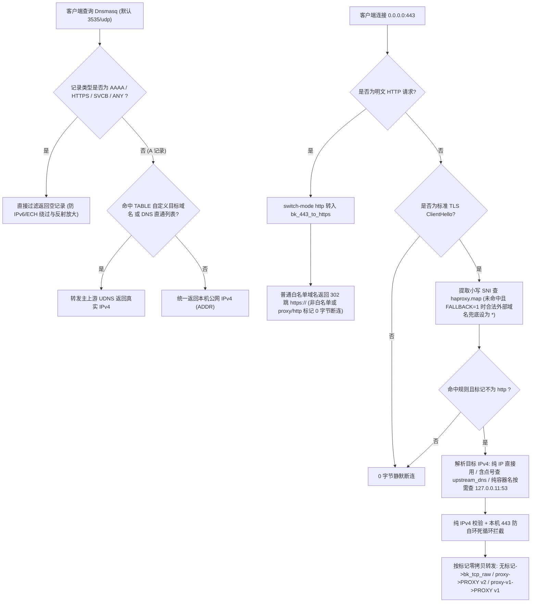
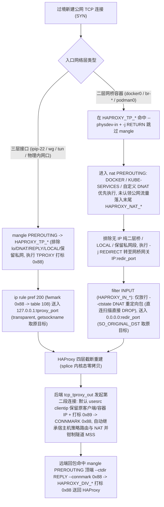

# HAProxy IPv4 双模式通用组件（SNI/DNS 解锁 + TPROXY/REDIRECT 透明 TCP 截断）

同一个镜像内置两组纯 IPv4 生产配置，通过环境变量 **`TPROXY`** 一键切换：
1. **模式 A（默认不传 `TPROXY` 或设为 `0`）**：**SNI / Host 动态分流 + 单实例 Dnsmasq 解锁模式**（加载 `haproxy.cfg` + `haproxy.map` + `dnsmasq.conf`，全程与宿主机 DNS 物理隔离）。
2. **模式 B（传入 `TPROXY=1` 或 `TPROXY=<网卡/网段>`）**：**通用即插即用透明四层 TCP 截断插口模式**（加载 `haproxy-tproxy.cfg`，采用**三层 `TPROXY` + 二层网桥 `NAT REDIRECT` 双引擎**，完全不修改宿主机 `bridge-nf-call-iptables`，无缝兼容非 host 网桥容器、跨容器公网映射端口互访 Hairpin DNAT 与 K8s，默认利用 `usesrc clientip` 原样继承宿主机策略路由与 NAT，`docker stop` 自动无损还原）。

---

## 目录文件说明

| 文件名 | 容器内路径 | 作用说明 |
| :--- | :--- | :--- |
| `haproxy.cfg` | `/etc/haproxy/haproxy.cfg` | **模式 A** 配置：80/443 SNI/Host 动态分流、三种域名粒度、PROXY v1/v2、443 明文 HTTP 跳 HTTPS、防自环保护 |
| `haproxy.map` | `/etc/haproxy/haproxy.map` | **模式 A** 路由映射表（启动时由 `run.sh` 解析 `TABLE` 自动排序生成） |
| `dnsmasq.conf` | `/etc/haproxy/dnsmasq.conf` | **模式 A** 对外劫持 DNS 配置（默认 `3535/udp`，开启 `no-resolv`/`no-hosts`，自动过滤 `AAAA`/`HTTPS`/`SVCB`/`ANY`） |
| `haproxy-tproxy.cfg` | `/etc/haproxy/haproxy-tproxy.cfg` | **模式 B** 配置：三层 `TPROXY` + 二层网桥 `REDIRECT` 双引擎全端口透明 TCP 截断重建，内置 `dst_is_local` 防自环保护 |
| `run.sh` | `/run.sh` | 容器统一入口脚本（模板还原、配置渲染、规则挂载、就绪探测与信号自愈清理） |
| `buildx.sh` | *(构建宿主机执行)* | 多架构（`amd64` + `arm64`）镜像构建与 Manifest 推送脚本 |
| `commit.sh` | *(构建期容器内执行)* | 容器环境初始化、配置写入与构建期语法自检脚本 |
| `update.sh` | *(构建期容器内执行)* | 安装静态编译包 `haproxy_${arch}_v*.tar.gz` 与 `dnsmasq_${arch}_v*.tar.gz` |
| `haproxy_musl.sh` | *(独立交叉编译脚本)* | 静态编译支持 kTLS / PCRE2 JIT / TPROXY / Netfilter 的 musl 版 HAProxy 二进制 |

---

## 第一部分：运行工作流详解

### 0. 公共启动预处理（`run.sh`）
1. **目录与模板还原**：创建 `/var/run` 与配置目录（默认 `/etc/haproxy`）。首次启动将 `dnsmasq.conf`、`haproxy.cfg`、`haproxy-tproxy.cfg` 备份为 `.tpl` 原始模板；后续每次 `docker restart` 均从 `.tpl` 重新覆盖还原，杜绝重复追加污染。
2. **时区同步**：若传入有效 `TZ` 变量，同步覆盖 `/etc/localtime`（镜像构建期默认 `Asia/Shanghai`）。
3. **运行模式判定**：读取 `TPROXY`（去空白并转小写）：
   - 为空、`0`、`false`、`off`、`no` → 进入 **模式 A**；
   - 为 `clean`、`clear`、`reset` → 执行一次跨表全量清理后立即退出；
   - 其余非空值 → 进入 **模式 B**。

---

### 1. 模式 A 工作流：SNI / Host 动态分流 + Dnsmasq 解锁

#### 1.1 启动控制流
1. **监听网卡与公网 IPv4 探测**：确定网卡 `device`（优先 `DEVICE`，否则查默认路由网卡，兜底首个非 `lo` 网卡）；确定劫持应答 IPv4 `addr`（优先 `ADDR`，否则依次向 `checkip.amazonaws.com`、`ipv4.icanhazip.com`、`api.ipify.org` 探测，全部超时则回退取 `device` 网卡 IPv4）。
2. **隔离式 DNS 与配置渲染**：解析 `UDNS` 与 `UPORT`，同时写入 `haproxy.cfg` 的 `resolvers upstream_dns` 与 `dnsmasq.conf` 的 `server=`；写入监听网卡、端口及全量劫持记录 `address=/#/<addr>`。全程不读取容器或宿主机的 `/etc/resolv.conf` 与 `/etc/hosts`。
3. **转发表与直通域名生成**：
   - 解析 `TABLE` 拆解三种域名粒度，按**域名长度降序 + 精确匹配优先于泛子域**写入 `haproxy.map`；
   - 将 `TABLE` 中配置了自定义转发目标的域名与环境变量 `DNS` 中的域名合并清洗去重，统一写入 `dnsmasq.conf` 的 `server=/<domain>/<主UDNS>#<端口>`（直通真实解析，不劫持为本机 IP）。
4. **语法校验与常驻运行**：执行 `haproxy -c` 校验配置；若 `PORT` 未禁用，执行 `dnsmasq --test` 并启动 `dnsmasq`；最终 `exec haproxy -W -db -f /etc/haproxy/haproxy.cfg` 接管 PID 1。

#### 1.2 数据面流转

- **80 端口（`http_in` → `bk_http_raw`）**：非 HTTP 流量在四层直接 0 字节断连；合法 HTTP 提取 `Host` 查同一个 `haproxy.map`：
  - 标记为 `proxy` / `proxy-v1` → 0 字节断连；
  - 带有自定义端口且**未标** `http`（代表本机其他端口上的 HTTPS 服务）→ 自动返回 `301` 跳转 `https://`；
  - 其余（普通解锁 `*` 或标了 `http` 的纯明文后端）→ 解析目标 IPv4，通过本机 80 防自环检查后原样转发。

---

### 2. 模式 B 工作流：三层 `TPROXY` + 二层网桥 `REDIRECT` 双引擎透明截断

#### 2.1 启动与退出自愈流程
1. **双端口分配与配置渲染**：解析 `TPROXY` 参数；选定三层 `TPROXY` 监听端口 `tproxy_port`，开启自动拦截时额外分配互不冲突的二层 `REDIRECT` 端口 `redir_port`（均从 `10000..29999` 排除当前 `/proc/net/tcp` 与 `tcp6` 已占端口随机挑选），渲染 `haproxy-tproxy.cfg` 并执行 `haproxy -c` 校验。
2. **先监听、后挂流**：后台拉起 HAProxy 并注册 `TERM/INT/QUIT/USR1` 信号钩子；轮询 `/proc/net/tcp` 确认 `tproxy_port` 与 `redir_port` 均进入 `0A (LISTEN)` 状态后，再执行 `setup_tproxy` 挂载策略路由与三表规则，实现 0 毫秒断流切换。
3. **停止与异常退出自愈**：收到停止信号或 HAProxy 进程意外退出时，自动执行 `cleanup_tproxy`，同时清扫 `iptables` 与 `iptables-legacy` 的 `mangle`/`nat`/`filter` 三表 `HAPROXY_*` 子链及 `pref 200/201`、`table 108` 策略路由，瞬间恢复宿主机原网络状态。

#### 2.2 双引擎数据面流转（不改动 `bridge-nf-call-iptables`）


---

## 第二部分：全部环境变量与取值格式规范

### 1. 全局通用环境变量

| 变量名 | 默认值 | 取值格式与说明 |
| :--- | :--- | :--- |
| **`TPROXY`** | *(空)* | **核心模式总开关**：<br>• 留空 / `0` / `false` / `off` / `no`：运行**模式 A**<br>• `clean` / `clear` / `reset`：清除宿主机所有残留 `TPROXY`/`REDIRECT` 规则与策略路由后退出<br>• 其余非空值：运行**模式 B**（详下表） |
| **`LOWAT`** | `131072` | **TCP 动态背压水位**（同时控制 `tune.notsent-lowat.client` 与 `.server`，初始模板默认注释关闭）：<br>• 大于 `0`（如默认 `131072`，支持 `64k` / `128k` / `256k` 等单位）：自动取消注释并设置对应字节数，启用动态背压攒包与防 Bufferbloat<br>• `0`（或 `off` / `false` / `no` / `none`）：保持注释不启用该特性 |
| **`TZ`** | `Asia/Shanghai` | 标准时区名称（对应 `/usr/share/zoneinfo/${TZ}`，如 `UTC`、`Asia/Tokyo`） |
| **`CONF_DIR`** | `/etc/haproxy` | 容器内配置文件目录路径 |

---

### 2. 模式 A 专用环境变量（SNI / Host 分流 + DNS 解锁）

| 变量名 | 默认值 | 取值格式与规则说明 |
| :--- | :--- | :--- |
| **`TABLE`** | *(空)* | **核心路由映射规则**，多条规则用 `;` 分隔，单条格式：**`源域名[,转发目标[,可选标记]]`**<br>**① 第 1 列 `源域名`**（严禁含 `:`）：<br>• `abc.com`：同时匹配根域 `abc.com` 与所有子域 `*.abc.com`<br>• `^abc.com`（或 `@abc.com`）：仅精确匹配单域名 `abc.com`<br>• `*.abc.com`：仅匹配泛子域名，不含根域 `abc.com`<br>**② 第 2 列 `转发目标`** *(可选)*：<br>• 留空或 `*`：解锁模式，按客户端请求的原域名动态解析 IPv4 转发<br>• `<端口>`（如 `50443`）：解析原请求域名，转发至该指定端口（`*:<端口>`）<br>• `<IPv4或域名或同网桥容器名>`（如 `172.17.0.3` 或 `ocserv`）：自动补默认端口（`http` 补 `:80`，其余补 `:443`）<br>• `<主机>:<端口>`（如 `172.17.0.3:50443` 或 `ocserv:50443`）：转发至指定地址与端口<br>*(注：凡带自定义转发目标的域名，会自动加入 Dnsmasq 直通上游真实解析，不被劫持为本机 IP)*<br>**③ 第 3 列 `可选标记`** *(可选，大小写不敏感)*：<br>• 留空：标准四层 TLS / 七层 HTTP 透传<br>• `proxy`（别名 `proxy_protocol` / `proxy-v2` / `proxy_v2`）：向后端发送 **PROXY Protocol v2** 头（80 端口及 443 明文 HTTP 访问直接 0 字节断连；兼容第 2 列末尾空格旧写法如 `50443 proxy`）<br>• `proxy-v1`（别名 `proxy_v1`）：向后端发送 **PROXY Protocol v1** 文本头<br>• `http`：声明纯明文 HTTP 后端（仅响应 80 端口且不跳 HTTPS，443 访问直接断连） |
| **`PORT`** | `3535` | Dnsmasq 对外劫持 DNS 监听的 UDP 端口：<br>• `1` ~ `65535`：启动 Dnsmasq 监听该端口<br>• `0` / `off` / `false` / `no` / `none`：**禁用 Dnsmasq**，仅运行纯 HAProxy 80/443 分流 |
| **`ADDR`** | *(自动探测)* | Dnsmasq 劫持应答的本机公网 IPv4（同时作为 HAProxy 80/443 防自环校验地址）。留空时自动通过公网 API 探测，超时则回退取 `DEVICE` 网卡 IPv4 |
| **`DEVICE`** | *(自动探测)* | Dnsmasq 绑定的网卡名。留空时优先取默认路由网卡，兜底首个非 `lo` 网卡（容器内通常为 `eth0`） |
| **`UDNS`** | `8.8.4.4;1.1.1.1` | 上游真实公网 IPv4 DNS 列表，多个用 `;` 分隔。单条支持 `IP`、`IP:端口`、`IP#端口`（如 `8.8.4.4;1.1.1.1:5353;9.9.9.9#53`） |
| **`UPORT`** | `53` | `UDNS` 条目未单独指定端口时使用的默认上游端口（`1` ~ `65535`） |
| **`DNS`** | *(空)* | 额外需要在 Dnsmasq 中直通上游真实解析（不劫持为 `ADDR`）的域名列表，多个用 `;` 分隔（自动清洗 `^`/`@`/`*.` 前缀并与 `TABLE` 直通项合并去重） |
| **`FALLBACK`** | `0` | 未命中 `TABLE` 时的处理策略：<br>• `0`：严格白名单，未命中域名一律 0 字节断连<br>• `1`：泛域名解锁，所有未命中的合法外部域名（含 `.` 且非纯 IP）自动按原端口动态解析转发 |

---

### 3. 模式 B 专用环境变量（`TPROXY` 透明四层 TCP 截断插口）

#### 3.1 极简单值写法（不含逗号 `,`）

| 取值示例 | 含义说明 |
| :--- | :--- |
| `TPROXY=1` *(或 `auto` / `true` / `yes` / `on`)* | **全自动全局接管**：透传客户端源 IP，自动选双空闲端口，自动接管本机除默认公网口以外的所有三层接口与二层网桥容器公网 TCP |
| `TPROXY=ipip-22` / `TPROXY="192.168.144.0/24;vpns+"` | **按指定入口精准接管**：多个网卡名（支持末尾 `+` 通配符）、网桥名或 IPv4 源地址/网段之间统一用 **`;`** 分隔，其余参数全自动 |
| `TPROXY=10888` / `TPROXY=*:10888` / `TPROXY=127.0.0.1:10888` | **指定三层监听端口**，其余参数全自动 |
| `TPROXY=clean` *(或 `clear` / `reset`)* | **应急一键清理**：清除宿主机残留规则与策略路由后立即退出 |

#### 3.2 四段完整自定义写法：`TPROXY=[SOURCE],[BIND:]PORT[,INPUT[,FWMARK]]`

| 列序 | 字段 | 默认值（留空时） | 支持的取值格式 |
| :--- | :--- | :--- | :--- |
| 第 1 列 | **`SOURCE`** | `client` | • 留空 / `auto` / `client` / `clientip`：透明绑定原客户端源 IP（`usesrc clientip`）<br>• `local` / `*` / `0.0.0.0`：改用宿主机自身出口 IP 发起后段连接<br>• `<IPv4>`（如 `10.255.22.1`）：强制绑定指定源 IPv4 地址 |
| 第 2 列 | **`[BIND:]PORT`** | `127.0.0.1:auto` | 三层 `TPROXY` 监听地址与端口：<br>• `BIND`：省略或留空为 `127.0.0.1`；填 `*` 为 `0.0.0.0`；或填具体本机 IPv4<br>• `PORT`：省略 / `0` / `auto` 自动从 `10000~29999` 挑选空闲端口；或填 `1~65535`（开启自动拦截时，二层 `REDIRECT` 端口始终另行自动分配空闲端口并在 `INPUT` 封堵非重定向直连） |
| 第 3 列 | **`INPUT`** | `auto` | • 留空 / `auto` / `all` / `1` / `true`：自动挂载 `! -i <默认公网口>`<br>• `off` / `none` / `0` / `manual` / `false`：关闭自动 `iptables` 与策略路由，仅前台运行 HAProxy<br>• `<入口列表>`：用 `;` 分隔的网卡名（如 `ipip-22`、`vpns+`）、网桥名（如 `docker0`）或源 IPv4/CIDR（如 `192.168.144.0/24`） |
| 第 4 列 | **`FWMARK`** | *(自动)* | • 留空 / `0` / `0x0`：当 `SOURCE` 非 `local` 时自动使用内部 `0x89` 做回包追踪<br>• 十进制（如 `100`）或十六进制（如 `0x64`）：设置后端出站包 `fwmark`；若宿主机存在同号路由表（`table 100`），自动添加 `ip rule pref 201 fwmark <值> lookup <值>` |

---

### 4. 构建期可选环境变量（`update.sh`）

| 变量名 | 默认值 | 说明 |
| :--- | :--- | :--- |
| **`ENDPOINT`** | `https://github.com/MoeClub/Note/raw/refs/heads/master/AnyConnect/build` | 构建镜像且本地未放置 `haproxy_*.tar.gz` / `dnsmasq_*.tar.gz` 时，下载预编译静态包的远端 URL 前缀 |

---

## 第三部分：常用启动与构建示例

### 1. 模式 A 启动示例（SNI / Host 分流 + DNS 解锁）
```bash
docker run --restart always --name sniproxy \
  -p 0.0.0.0:80:80/tcp \
  -p 0.0.0.0:443:443/tcp \
  -p 0.0.0.0:3535:3535/udp \
  -e "PORT=3535" \
  -e "FALLBACK=0" \
  -e "TABLE=abc.com,50443,proxy; xyz.net,20443,proxy; openai.com; chatgpt.com; claude.ai; gemini.google.com" \
  -dt ocserv/haproxy
```

### 2. 模式 B 启动示例（透明四层 TCP 截断加速）
```bash
# 场景 1：零配置接管本机全部三层隧道与二层网桥容器过境公网 TCP
docker run --restart always --name haproxy-tproxy \
  --network host --privileged \
  -e "TPROXY=1" \
  -dt ocserv/haproxy

# 场景 2：精准接管指定隧道口与指定容器网段（多路用 ; 分隔）
docker run --restart always --name haproxy-tproxy \
  --network host --privileged \
  -e "TPROXY=ipip-22;192.168.144.0/24" \
  -dt ocserv/haproxy

# 场景 3：应急一键清理（若曾用 docker rm -f / kill -9 强杀容器且不再启动代理时）
docker run --rm --network host --privileged -e "TPROXY=clean" ocserv/haproxy
```

### 3. 多架构镜像构建（Build）
```bash
# 参数：HAProxy版本  Dnsmasq版本  是否同步推送latest(1=是, 0=否)
sh ./buildx.sh 3.4.8 2.93 1
```
